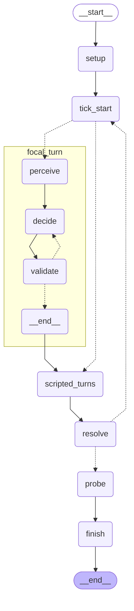

# Agent Society Lab

Does an LLM agent stop acting on a problem when passive bystanders are present, and does a named owner role restore action? One focal LLM agent shares a scene with 4 scripted, always-passive people, in a town square (a person collapses) or an office (a payments dashboard turns red).

Design: [docs/designs/design.md](docs/designs/design.md)

## Hypotheses (frozen before the batch runs)

- **H1 — diffusion:** the focal agent helps less often in `group5` than `alone`.
- **H2 — ownership:** the focal agent helps more often in `group5_owner` than in `group5`.
- **H3 — latency (descriptive):** among runs where the focal agent helps, it helps later in `group5` than `alone`.
- **H4 — exploratory:** effects differ by model, by scenario and by the persona's Agreeableness level.


## How it works

An outer LangGraph loop runs ticks 1 to 12. The focal agent's turn is a subgraph that perceives, decides (one LLM call), validates, and retries once if the reply is unusable. A deterministic game master applies every action and codes `counts_as_help`. Regenerate the diagram with `uv run asl graph`.



## Architecture

```
laptop                                   VPS (Docker Compose)
------                                   --------------------
asl CLI (Python 3.12, LangGraph)         caddy -> api (Spring Boot 4.1, Java 21) -> postgres 16
   |  one RunBundle per run  --POST-->      |  static pages: index.html, replay.html (Phaser 3.90.0)
   |  LLM calls: Workers AI, Anthropic      |  read-only REST: /api/runs, /api/results
```

`contracts/run-bundle.schema.json` is the single contract between the two runtimes. Visitors never trigger LLM calls: the site only replays stored runs.

## Run it locally (no keys needed)

```bash
docker compose -f deploy/docker-compose.dev.yml up -d
cd api && ./mvnw -B verify && ./mvnw spring-boot:run      # API and pages on :8080
cd engine && uv run pytest
uv run asl batch --models fake --runs 3 --seed 0           # 18 fake runs
```

Open http://localhost:8080 and follow a run's Replay link. Fake runs are excluded from the results tables.
